

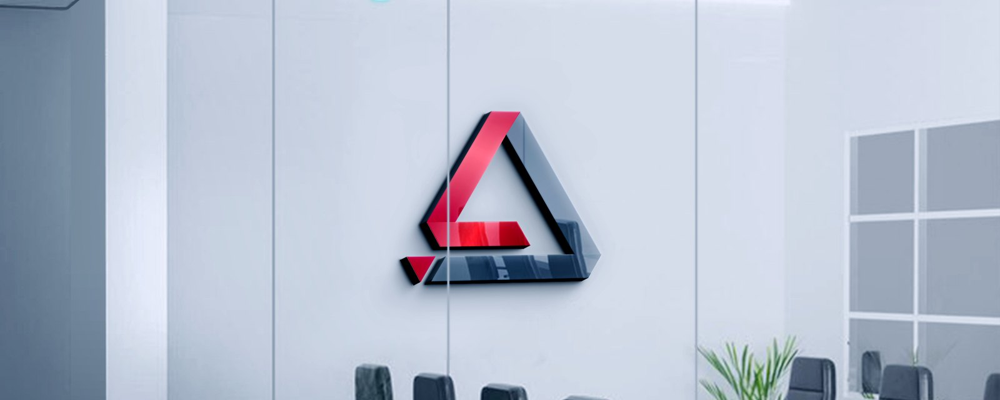

**Open-source projects for NAS, virtualization, the web and more.** 
Boot loaders and apps for DSM, a full hypervisor, a browser strategy game, a time tracking app and a shared UI kit.

---

<h2 align="center">🗺️ Overview</h2>

#### 📦 Arc Ecosystem — loaders and services for DSM 7.x

| Project | What it is | Links |
| :-- | :-- | :-- |
|  | [**Arc**](#arc) — guided Redpill loader that turns almost any x64 PC, mini-PC or VM into a DSM box | [Repo](https://github.com/AuxXxilium/arc) · [Download](https://github.com/AuxXxilium/arc/releases/latest) |
|  | [**Arx**](#arx) — the evolution of Arc, set up entirely from your browser | [Repo](https://github.com/AuxXxilium/arx) · [Download](https://github.com/AuxXxilium/arx/releases/latest) |
|  | [**Arc/Arx Flash**](#flash) — USB writer that flashes and updates loader sticks without losing settings | [Repo](https://github.com/AuxXxilium/arc-flash) · [Download](https://github.com/AuxXxilium/arc-flash/releases/latest) |
|  | [**Arc Custom Kernel**](#kernel) — DSM kernels with modern GPU, network and storage drivers | [Repo](https://github.com/AuxXxilium/arc-custom) |
|  | [**Arc Connect**](#connect) *(beta)* — reach your NAS from anywhere without port forwarding | — |
|  | [**Arc Web Management**](#web) — config backup, free DDNS, live monitoring and benchmarks | [Portal](https://arc.auxxxilium.tech) |

#### 🖥️ DSM Apps — install from Package Center → Community

| Project | What it is | Links |
| :-- | :-- | :-- |
|  | [**Arc Control**](#control) — loader config, monitoring, fan and CPU tuning right on the DSM desktop | Package Center |
|  | [**Arc VMM**](#vmm) *(beta)* — QEMU/KVM hypervisor for DSM with real PCI and GPU passthrough | Package Center |
|  | [**Arc Container**](#container) *(beta)* — container manager with its own, current Docker engine | Package Center |
|  | [**Arc AI**](#ai) *(beta)* — local LLMs on your NAS GPU plus the big online AI providers in one chat | Package Center |
|  | [**Syno NVIDIA Driver**](#nvidia) — NVIDIA GPU driver for DSM, with CUDA, NVENC and Docker support | Package Center |
|  | [**Video Compute Runtime**](#vcrt) — hardware-accelerated FFmpeg for Intel, AMD and NVIDIA | Package Center |

#### 🧩 Other Projects — standalone, not tied to DSM

| Project | What it is | Links |
| :-- | :-- | :-- |
|  | [**Ignis**](#ignis) — all-in-one hypervisor for VMs, containers and apps, managed from the browser | [Repo](https://github.com/AuxXxilium/ignis-hv) · [Download](https://github.com/AuxXxilium/ignis-hv/releases/latest) |
|  | [**Space Nova**](#nova) — browser space strategy game in an uncharted 3D galaxy | [Repo](https://github.com/AuxXxilium/nova) |
|  | [**Zeiterfassung**](#zeiterfassung) — time tracking, jobs and work reports for trade businesses | [Repo](https://github.com/AuxXxilium/zeiterfassung) · [Download](https://github.com/AuxXxilium/zeiterfassung/releases/latest) |
|  | [**One UI**](#one-ui) — the shared design system behind every Arc app | [Repo](https://github.com/AuxXxilium/one-ui) · [Demo](https://auxxxilium.github.io/one-ui/demo/) |

---

 

<h2 align="center">📦 Arc Ecosystem</h2>

<b>Customized Redpill loaders for DSM 7.x and the services around them. Each project stands on its own, but they are built to work together.</b>

> [!IMPORTANT]
> * Arc, Arx and DSM are **independent** from each other — Arc and Arx are boot helpers for DSM.
> * **Commercial use is not permitted and strictly forbidden.**
> * DSM and all parts of it are under copyright / ownership by Synology Inc.
> * The loaders are free and will stay free forever. If you paid a suspicious person for it, I can't help you — I'm not connected to them.

 

###  Arc

The loader itself — guided setup that turns almost any x64 PC, mini-PC or VM into a DSM 7.x box.

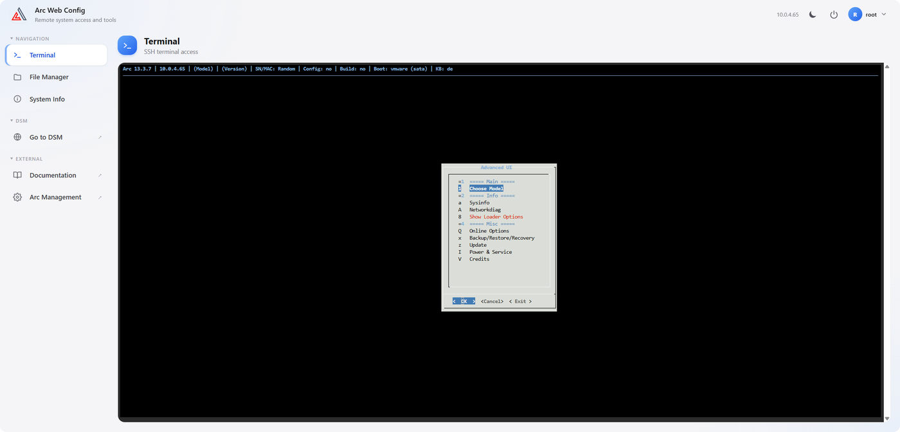

* **Guided or fully automated install** — a dialog-driven walkthrough (Model → DSM version → Add-ons → Build → Boot) or a hands-off automated mode
* **Hardware-aware model picker** — probes CPU flags, SATA/SAS/NVMe/RAID controllers, iGPU and thread count, then shows only models your hardware can actually run
* **Broad platform support** — apollolake, geminilake(nk), broadwell(nk/v2), purley, icelaked, epyc7002, epyc7003(ntb), r1000nk, v1000nk
* **Selectable custom kernel** — switch between Synology's stock kernel and Arc's own builds on supported platforms
* **Smart add-ons** — auto-enables what your hardware needs (NVMe, cpufreq scaling, sensors, LED control, i915, vmtools, SMART …)
* **Web UI & remote help** — browser config page, file upload service, web terminal, plus one-click remote assistance for support
* **Built-in updater** — update the loader, add-ons, modules, patches, configs and kernels from the menu, each from its own release channel
* **Rescue toolbox** — reset DSM passwords, add an admin, force-enable SSH, clear blocked IPs, restore config or `machine.key`, clone the loader, edit cmdline/synoinfo and much more

<a href="https://github.com/AuxXxilium/arc">Repository</a> ·
<a href="https://github.com/AuxXxilium/arc/releases/latest">Releases</a>

---

 

###  Arx

The evolution of Arc — the Arc Loader, set up entirely from your browser.

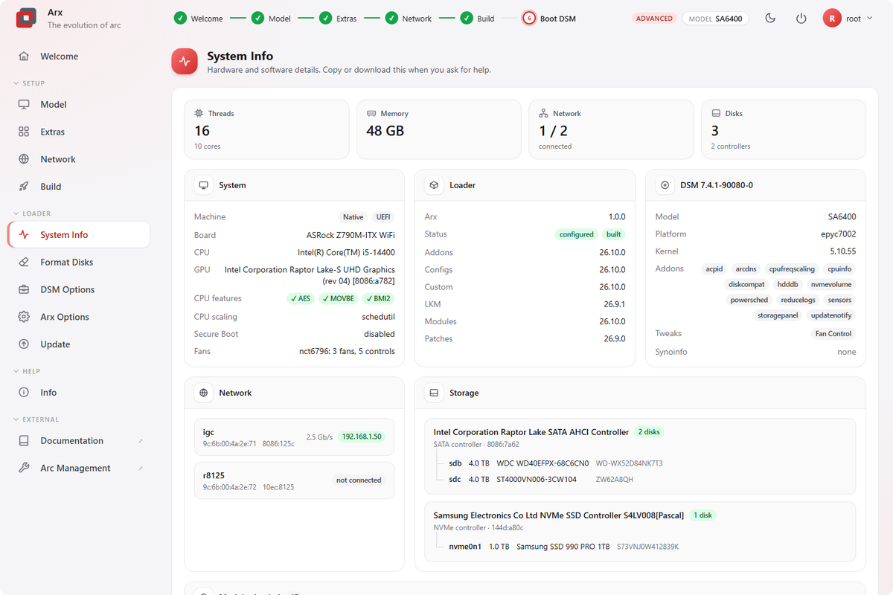

* **Setup in the browser** — a few simple steps with Back and Next, in plain words; the screen on the machine tells you which address to open
* **Arc at its core** — the same proven setup and build logic as the Arc Loader
* **Picks the right add-ons for you** — recognises whether it runs in a virtual machine or on real hardware, and what disks it has, and chooses to match
* **Model picker that knows your hardware** — shows what each model supports, like integrated graphics or M.2 drives, and highlights what your computer has
* **Tweaks** — optional fixes for CPU, memory, power saving, network and graphics, each a simple on/off switch
* **Starts DSM by itself** — once set up, switching the computer on goes straight into DSM
* **Follows DSM updates** — if DSM updates itself, Arx patches the update's own boot files on the next start and starts DSM, with no rebuild and no network needed
* **Updates itself** — with one click, or from a downloaded file when there is no internet
* **Format Disks** — wipe disks that held another system before installing DSM
* **Works offline** — everything it needs is on the loader disk

<a href="https://github.com/AuxXxilium/arx">Repository</a> ·
<a href="https://github.com/AuxXxilium/arx/releases/latest">Releases</a>

---

 

###  Arc/Arx Flash

The USB writer for Arc and Arx — put a loader on a stick, and update it later without losing its settings.

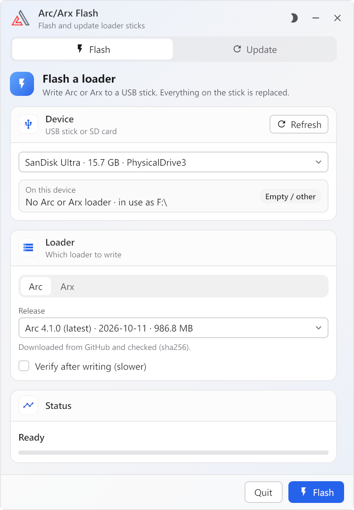

* **Flash** — writes an Arc or Arx release to a USB stick, downloaded from GitHub or from a local `.img` / `.img.zip`
* **Update** — puts a newer release on a loader stick and keeps its settings, the DSM partition, the password and the downloaded DSM files
* **Knows your sticks** — shows which loader and version each stick holds, and only offers removable disks, never the system disk
* **Checked downloads** — images are verified against GitHub's sha256 digest, with an optional read-back check after writing
* **Backups** — the files Update saves stay on your computer, the last 3 per loader
* **One file, nothing to install** — a native app for Windows, Linux and macOS, styled like Arc Control, with a command line as well

<a href="https://github.com/AuxXxilium/arc-flash">Repository</a> ·
<a href="https://github.com/AuxXxilium/arc-flash/releases/latest">Releases</a>

---

 

###  Arc Custom Kernel

Custom DSM kernels that add back the hardware Synology's own kernel never knew about.

* **Kernel 5.10.55 ABI** — stays compatible with DSM's prebuilt modules (parts backported from Linux 6.18)
* **Targets** — epyc7002, geminilakenk, r1000nk and v1000nk for DSM 7.2, 7.3 and 7.4; epyc7003 and icelaked for DSM 7.4
* **Modern GPU support** — backported i915 and amdgpu for hardware transcoding: Intel up to Meteor Lake incl. Arc A-series, AMD through RDNA 3.5 and Ryzen APUs *(headless — transcoding only, no display output)*
* **Huge network driver set** — Realtek 2.5G/5G, Intel, Aquantia, Mellanox, Broadcom, Solarflare, QLogic, Marvell and many USB adapters, plus WireGuard and modern TCP congestion algorithms
* **Storage & sensors** — MegaRAID, mpt3sas, smartpqi, hpsa, aacraid and more, with a broad hwmon set for temperatures and fan control
* **Virtualization & extras** — VFIO/GPU passthrough, virtio-fs, Hyper-V and VMware support, exFAT/NTFS/FUSE, USB4/Thunderbolt and Coral Edge TPU drivers

Built kernels are published as <a href="https://github.com/AuxXxilium/arc-custom">Arc Custom</a>.

---

 

###  Arc Connect &nbsp;

Reach your NAS from anywhere without port forwarding — a self-hosted alternative to QuickConnect.

* **Public HTTPS address for a NAS behind NAT** — your system becomes reachable at its own `connect` subdomain, with no router changes, no open ports and no dynamic DNS required
* **Reverse tunnel** — the NAS dials out and keeps one multiplexed connection open, so nothing has to be exposed to the internet
* **Works with DSM as-is** — the tunnel passes bytes through untouched, so DSM Web UI, File Station, Drive, Photos, Surveillance Station and the Synology mobile apps behave normally
* **Token-based access** — enter your Access Token to connect; the same token identifies your system in Arc Web Management
* **Sensors-only mode** — publish live hardware telemetry without exposing DSM at all
* **Live status** — reports whether the tunnel is up and whether DSM is actually being served, so a dashboard can tell the difference
* **Runs as a service** — installs with systemd units and reconnects automatically with backoff; on Arc installs the token is detected for you
* **Set up from Arc Control** — the Arc Connect tab configures and starts the client for you

> [!NOTE]
> Arc Connect is in beta. The token is the only credential in front of DSM's own login, so treat it like a password. Traffic is TLS-encrypted.

---

 

###  Arc Web Management

A hosted portal for your Arc systems — config backup, free DDNS, live monitoring and the community benchmark board.

* **Sign in with Discord** — no extra account and no separate password to manage
* **Register your systems** — add each loader's Access Token with a friendly name and see all of them in one place
* **Config backup & restore** — your loader uploads its configuration and system info, so you can pull it back after a rebuild or a new disk
* **Free ArcDNS hostname** — claim a `*.arcdns.tech` name for your NAS, with optional wildcard and a built-in connection check
* **Live monitoring through Arc Connect** — diagnostics, resource and network views for a connected system, plus a direct link into DSM
* **Benchmark scoreboard** — compare CPU and GPU results with the rest of the community, best result per chip
* **Shared dark mode** — matches the look of Arc Control and the loader web config

🌐 <a href="https://arc.auxxxilium.tech">arc.xpenology.tech</a>

---

 

<h2 align="center">🖥️ DSM Apps</h2>

<b>The following install directly in DSM. Add the package source once, then find them in Package Center → Community. Updates then arrive through Package Center like any other app — no manual <code>.spk</code> download needed.</b>

 

###  Arc Control

A DSM app that brings loader configuration, monitoring and hardware tuning to your Synology desktop — no reboot into config mode needed.

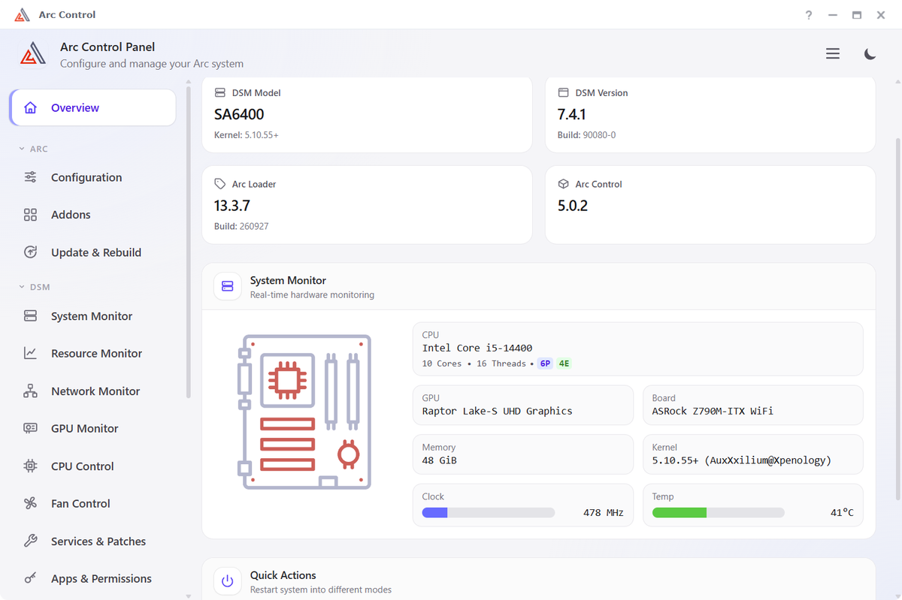

* **Edit the loader config from DSM** — model, DSM version, serial, MACs, USB VID/PID, SataDOM, cmdline and more, with config backup
* **Add-on management** — browse, search and toggle add-ons; get notified when a loader update is available
* **One-click reboot into any mode** — rebuild, update, config, recovery, automated, junior or UEFI
* **Live monitoring** — CPU, RAM, clocks, temperatures, disk I/O, full SMART per drive, NVMe, network throughput and an NVIDIA tab when a card is present
* **CPU & power tuning that survives reboot** — thread count, governor, turbo, energy preference, P-core/E-core pinning and dynamic power saving
* **Fan control** — three-point temperature curves for Full/Cool/Quiet modes with a live graph *(needs supported hardware)*
* **Services & patches** — Arc Connect remote access, storage panel matching, HDD/SSD database, Synology Photos and Surveillance Station patches, UGREEN LED control
* **Diagnostics** — storage/CPU/encode benchmarks, speedtest, kernel log, module list, browser terminal and a one-click report for support
* **DSM integration** — desktop app tile plus a widget showing version, temperature, CPU clock, load and disk I/O

📦 Package Center → Community → **Arc Control**

---

 

###  Arc VMM &nbsp;

A standalone QEMU/KVM hypervisor packaged for DSM — virtual machines with real PCI passthrough, without Synology's Virtual Machine Manager.

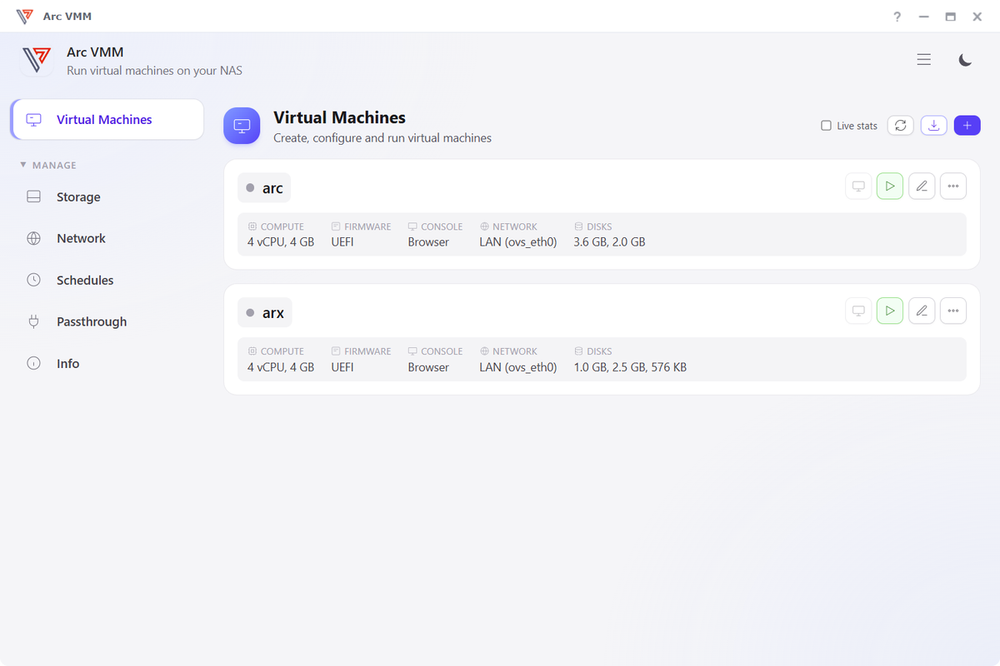

* **Full VM lifecycle** — create, edit, delete, start, shut down and force off; BIOS or UEFI, NUMA split, autostart
* **Flexible disks** — create qcow2/raw images, reuse existing ones, or hand a whole physical disk to a guest
* **Virtual networks** — isolated or bridged onto a NIC, with multiple adapters per machine
* **PCI & GPU passthrough** — binds the full IOMMU group to `vfio-pci`, lists devices and warns about group mates *(the thing Synology VMM cannot do)*
* **Browser console** — noVNC behind DSM's own login, so the console has no LAN presence; optional temporary VNC port with an expiring password
* **Snapshots & scheduling** — offline disk snapshots plus scheduled start, shutdown or snapshot with retention
* **Import & export** — JSON for lossless moves, OVA for Proxmox, ESXi or VirtualBox
* **Coexists with Synology VMM** — never touches its libvirtd or API

> [!NOTE]
> Arc VMM is in beta. Requires DSM 7.x on a Linux 5.x model (kernel 5.10.55: `epyc7002`, `epyc7003`, `geminilakenk`, `icelaked`, `r1000nk` or `v1000nk`) with hardware virtualization; IOMMU for passthrough.
> Designed to work flawlessly with the [Arc Custom Kernel](https://github.com/AuxXxilium/arc-custom) (`legacy`).

📦 Package Center → Community → **Arc VMM**

---

 

###  Arc Container &nbsp;

A container manager for DSM with its own, current Docker engine — independent of Synology's Container Manager and the Docker version it is stuck on.

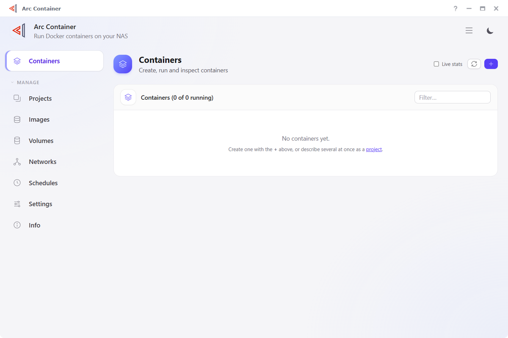

* **Current Docker engine** — Docker's own static builds, updated with the package, so compose v2, the newer mount syntax and buildx just work
* **Containers** — create with a guided editor (ports, mounts, environment, devices, limits), start, stop, restart, pause, inspect and remove; change restart policy and limits without recreating
* **Compose projects** — edit, bring up, take down, update and read the logs of a whole stack
* **Images, volumes & networks** — pull with Docker Hub search and tag browser, bridge and macvlan networks, registry sign-in and mirrors
* **Logs & live stats** — filter, follow and download logs; live CPU, memory, network and disk use per container
* **Updates on a schedule** — one-step update for a project or container, plus timed update, start and stop tasks
* **Housekeeping** — disk usage per type with cleanup, and a choice of volume for the image store
* **Coexists with Container Manager** — its own daemon, socket and image store; never touches Synology's

> [!NOTE]
> Arc Container is in beta. Requires DSM 7.x on a Linux 5.x model (kernel 5.10.55: `epyc7002`, `epyc7003`, `geminilakenk`, `icelaked`, `r1000nk` or `v1000nk`) and the Arc or Arx Loader. Images and containers are not shared with Container Manager, and both cannot publish the same host port.
> Designed to work flawlessly with the [Arc Custom Kernel](https://github.com/AuxXxilium/arc-custom) (`legacy`).

📦 Package Center → Community → **Arc Container**

---

 

###  Arc AI &nbsp;

Run large language models on your NAS, accelerated by its GPU, and chat with the big online AI providers — all from one DSM app.

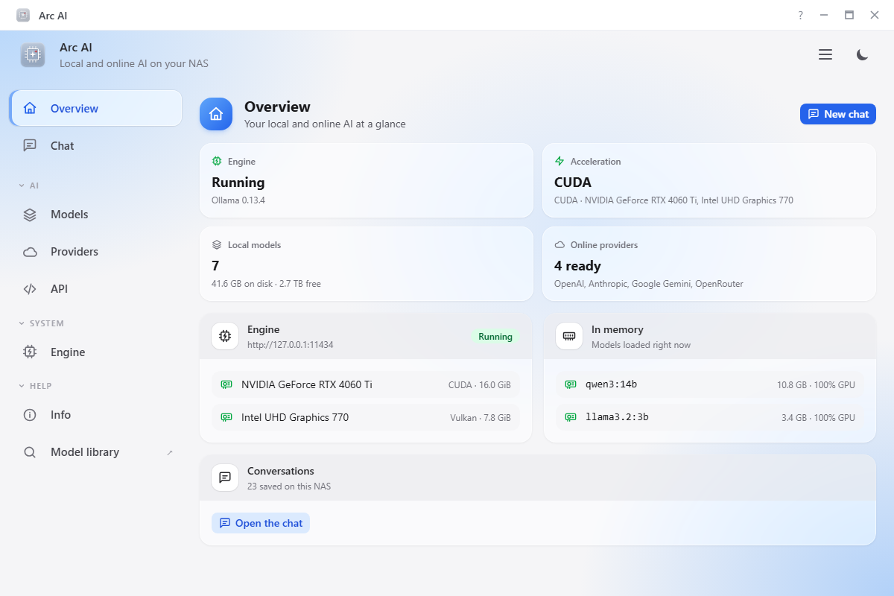

* **Local models with Ollama** — pull from the Ollama library or Hugging Face, then load, unload or delete them from the UI
* **GPU acceleration** — NVIDIA (CUDA), Intel (Vulkan, integrated graphics and Arc cards) and AMD (Vulkan, or ROCm where supported); the Vulkan drivers ship with the package
* **Online providers with your own key** — OpenAI, Anthropic, Google Gemini, Azure OpenAI, Mistral, Groq, OpenRouter, xAI, DeepSeek, Together, Fireworks, Perplexity, Cerebras, Cohere and Hugging Face
* **Custom endpoints** — as many as you like, speaking OpenAI-compatible (LM Studio, vLLM, LocalAI, llama.cpp, LiteLLM), Anthropic, Gemini or Ollama on another machine
* **One chat for everything** — streaming answers, folded reasoning, Markdown and code, a system prompt per chat, and conversations saved on the NAS
* **Files, images and web search** — attach text files, PDFs and images; switch on web search per chat through a built-in SearXNG, your own SearXNG or the Brave Search API, with sources listed in the answer
* **Universal API** — one endpoint on the NAS for every local and online model, speaking both OpenAI's and Ollama's API behind Arc AI's own access tokens, so apps like Open WebUI or Home Assistant never hold your provider keys
* **Acceleration check** — checks kernel driver, engine backend and userspace for every GPU and names whatever is missing

> [!NOTE]
> Arc AI is in beta. x86-64 only, DSM 7.2 and later. NVIDIA acceleration needs the [Syno NVIDIA Driver](#nvidia) package. Conversations with local models never leave the NAS.

📦 Package Center → Community → **Arc AI**

---

 

###  Syno NVIDIA Driver

Run a real NVIDIA GPU on your NAS — install the driver from DSM and pass it into Docker.

**Linux 5.x only** — needs a DSM kernel 5.10.55 platform: `epyc7002`, `epyc7003`, `geminilakenk`, `icelaked`, `r1000nk` or `v1000nk`. It does not install on 4.4 platforms.

* **Installs as a normal DSM package** — a small `.spk` that fetches the driver on demand instead of bundling it
* **Pick and switch versions from a UI** — its own web UI plus a tab in Arc Control; install, start, stop, switch or remove without SSH
* **Driver branches** — 595.x, 580.x, 550.x, 535.x LTSB and 470.x with a recommendation per GPU from a built-in compatibility table
* **Platform support** — DSM 7.2+ on kernel 5.10.55 platforms (epyc7002, v1000nk, r1000nk, geminilakenk), DSM 7.4 on epyc7003 and icelaked; modules are compiled per platform
* **Stock or Arc kernel** — every driver is built for Synology's stock kernel and for the Arc Custom Kernel, and the package installs the one matching the kernel you boot
* **Full CUDA / NVENC / NVDEC userspace** — including `nvidia-smi`, persistence mode and automatic device node creation
* **Docker & Container Manager GPU support** — optional NVIDIA Container Toolkit layer that registers the `nvidia` runtime and re-asserts it after updates
* **Optional NVENC ffmpeg layer** — a jellyfin-ffmpeg build pinned to the driver's NVENC API

> [!NOTE]
> Physical / passthrough GPUs only — no vGPU and no license server.

📦 Package Center → Community → **NVIDIA Driver**

---

 

###  Video Compute Runtime (VCRT)

A modern, fully hardware-accelerated FFmpeg for DSM — Intel Quick Sync, AMD VCN and NVIDIA NVENC in one package.

* **FFmpeg 8.1.2 for DSM** — installs *alongside* DSM and never patches or replaces Synology's own ffmpeg
* **Intel Quick Sync & VAAPI** — iHD and i965 drivers, Media Driver, oneVPL and OpenCL, with a legacy fallback so Gen8–Gen11 (Skylake → Ice Lake, Gemini Lake, Jasper Lake) get QSV too
* **AMD acceleration** — Mesa radeonsi VAAPI with VCN decode *and* encode, RADV Vulkan and AMF, covering Polaris through RDNA 3
* **NVIDIA NVENC / NVDEC / CUDA** — compiled in, working through the NVIDIA driver package
* **Split into base + vendor packages** — download only the driver stack your hardware needs; either side updates independently
* **Broad codec coverage** — H.264, HEVC, AV1 (dav1d/SVT-AV1/libaom), VP8/VP9, VVC, AAC, Opus, FLAC, JPEG XL, WebP, plus subtitles, tone mapping, VMAF and SRT/RIST/RTMP streaming
* **~100 Jellyfin patches** — tone mapping, Dolby Vision and HDR10+ handling, CUDA/OpenCL/VAAPI/QSV filters
* **GPU diagnostics included** — `vainfo`, `vulkaninfo`, `clinfo` and render node permission setup

> [!NOTE]
> Hardware acceleration is x86-64 only. VCRT installs binaries you can point any app or script at.

📦 Package Center → Community → **Video Compute Runtime**, plus **- Intel** or **- AMD** for your GPU

---

 

<h2 align="center">🧩 Other Projects</h2>

<b>Standalone projects that are not directly related to Arc, Arx or DSM.</b>

 

###  Ignis

An all-in-one hypervisor for your own x86-64 PC or server — virtual machines, containers and apps, installed once and managed from the browser.

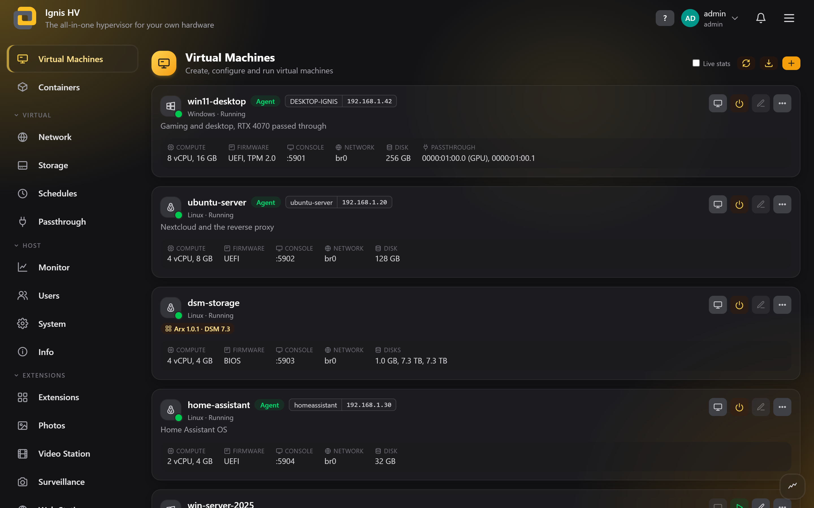

* **Virtual machines** — Windows and Linux with TPM 2.0 and Secure Boot, a screen in the browser, snapshots, scheduled backups, import from ESXi, Hyper-V, VirtualBox or `.ova`, and passthrough for GPUs, NICs, controllers, USB and whole disks
* **Containers** — Docker and compose projects with logs, live usage and updates that roll back if they fail
* **Storage and the host** — system on one disk or a mirror, data on software RAID, disk health checks, live monitoring and history, and several hosts linked into one interface
* **Apps from the Extensions tab** — network shares, Drive, Photos, Video Station, Surveillance, Web Station, VPN, game servers, AI and more, each updated on its own
* **DSM machines** — an app that sets up DSM virtual machines with the Arx loader and keeps the loader up to date
* **Safe updates** — the system is replaced as a whole and the previous version stays in the boot menu, while machines, containers and app data are never touched

> [!WARNING]
> Ignis is a complete system that installs to the machine's own disks and **erases every disk you select** for it. It does not run alongside another operating system.

<a href="https://github.com/AuxXxilium/ignis-hv">Repository</a> ·
<a href="https://github.com/AuxXxilium/ignis-hv/releases/latest">Download</a>

---

 

###  Space Nova

A browser space strategy game — grow your planets, research technology, build fleets and explore an uncharted 3D galaxy where every world is revealed only when a fleet first reaches it.

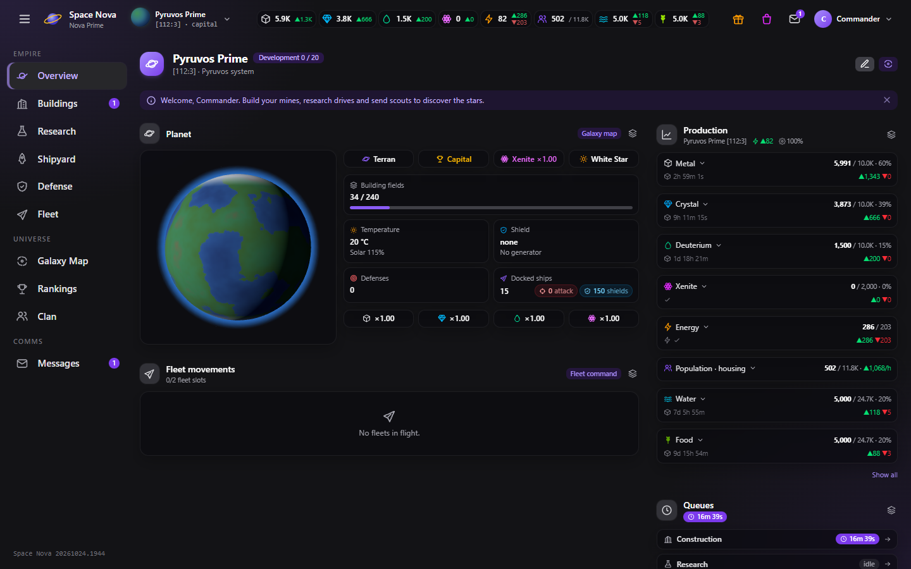

* **Build up your planets** — mines, energy, population, water and food, with production and queues at a glance
* **Research and shipyard** — technologies that count on every planet, and warships, civil and exploration ships
* **A 3D galaxy to chart** — every planet starts undiscovered; send probes to find free worlds, other empires, pirate havens, derelicts and anomalies
* **Fleets and combat** — spy, transport, colonize, attack and intercept, plus expeditions into deep space
* **Play together** — clans with shared star charts, rankings and messages between commanders
* **Player guides** — a beginner's guide and in-depth guides for planets, buildings, research, ships, defenses, combat and exploration

<a href="https://github.com/AuxXxilium/nova">Repository &amp; guides</a>

---

 

###  Zeiterfassung

Time tracking, jobs and work reports for trade businesses — in the browser on the desktop and on the phone, where it installs like an app and keeps working offline. The interface is in German.

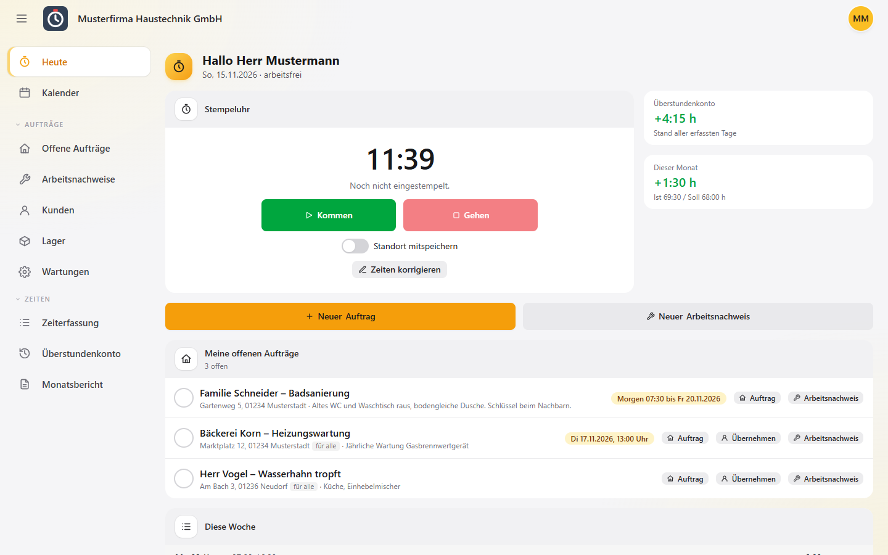

* **Time clock** — clock in, pause and clock out, optionally with location; a month view per day with vacation, sick days and public holidays of every German state
* **Overtime and monthly report** — an overtime account with history and payouts, and a monthly PDF in the layout of the DATEV working-time template, ready to send to payroll
* **Jobs and calendar** — open jobs with dates spanning days or weeks, assigned to a worker or to everyone, alongside vacation and training in one calendar
* **Work reports** — who worked where and how long, the work done, materials (typed, from a catalogue or as a straightened photo of a handwritten list), photos and signature, as a PDF or by e-mail
* **Customers, stock and lists** — a customer file that fills itself, stock levels with reorder PDFs, and custom keyword lists such as maintenance with due dates per customer
* **Roles and audit log** — employees, a boss and administrators, visible areas per user, and every change logged with who, when and what
* **One file to run** — a single Linux binary behind nginx, Apache or Plesk; SQLite built in, MySQL/MariaDB optional

<a href="https://github.com/AuxXxilium/zeiterfassung">Repository &amp; guide</a> ·
<a href="https://github.com/AuxXxilium/zeiterfassung/blob/main/INSTALLATION.md">Installation</a> ·
<a href="https://github.com/AuxXxilium/zeiterfassung/releases/latest">Download</a>

---

 

###  One UI

A UI to rule them all — the same cards, buttons, colours and dark mode for every Arc app, so moving between them feels like using one product.

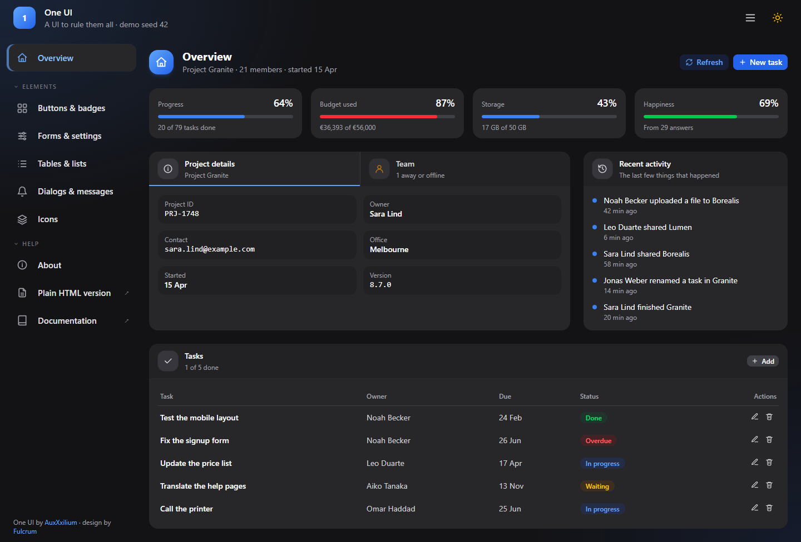

* **Two ways to use it** — a Tailwind preset with ready-made Preact components, or one CSS file and a small script for plain HTML with no build step; both look the same and share their settings
* **Light, dark, colour and glass** — one appearance menu for light or dark, solid or glass surfaces, and five highlight colours (Red, Blue, Amber, Graphite, Pastel Green), remembered in the browser
* **Ready-made layout** — `AppShell` with a sidebar that folds away on a phone, page headers, cards, tabs, tiles, buttons, status badges, form fields, modals, notices, progress bars and tables
* **Status colours that stay put** — green always means good and red always means a problem, whatever the highlight colour
* **App icons** — one script turns a flat icon into the frosted, frosted 3D or glyph 3D style the Arc apps use, keeping the symbol pixel for pixel
* **Live demo** — every element with sample content, in light, dark and glass

> [!NOTE]
> GPL-3.0. Every use, in full or in part, must credit [AuxXxilium](https://github.com/AuxXxilium) (development) and [Fulcrum](https://github.com/FulcrumCode) (theme and design) where users can see it; `AppShell` and `<Credits />` already do.

<a href="https://github.com/AuxXxilium/one-ui">Repository</a> ·
<a href="https://auxxxilium.github.io/one-ui/demo/">Live demo</a>

---

## 🧰 More from the Arc Project

| Project | Description |
| :-- | :-- |
| [Arc Loader Beta](https://github.com/AuxXxilium/arc-beta) | Beta releases of the Arc Loader |
| [Arc Utilities](https://github.com/AuxXxilium/arc-utils) | Tools to install, patch and activate DSM apps on Xpenology |
| [FAQ & Wiki](https://xpenology.tech/wiki) | **Read this first** |

---

## ⬇️ Download Arc & Arx

| Release | Download | Version | Downloads |
| :-- | :-- | :-- | :-- |
| **Stable** | [get it](https://github.com/AuxXxilium/arc/releases/latest) |  |  |
| **Beta** | [get it](https://github.com/AuxXxilium/arc-beta/releases/latest) |  |  |
| **Arx** | [get it](https://github.com/AuxXxilium/arx/releases/latest) |  |  |
| **Arc/Arx Flash** | [get it](https://github.com/AuxXxilium/arc-flash/releases/latest) |  |  |

Write the loader image to a USB stick with **[Arc/Arx Flash](https://github.com/AuxXxilium/arc-flash/releases/latest)** *(recommended)*, [Rufus](https://rufus.ie) or [balenaEtcher](https://etcher.balena.io). Only Arc/Arx Flash can also update a loader stick and keep its settings.

---

## 💬 Social & GitHub

